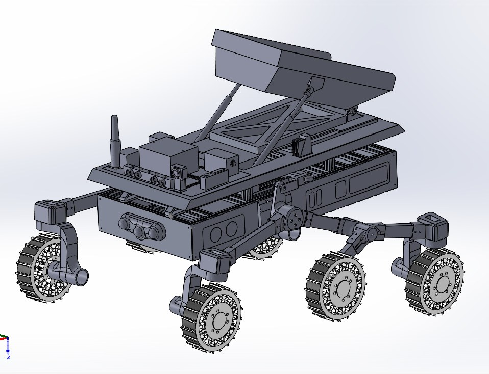
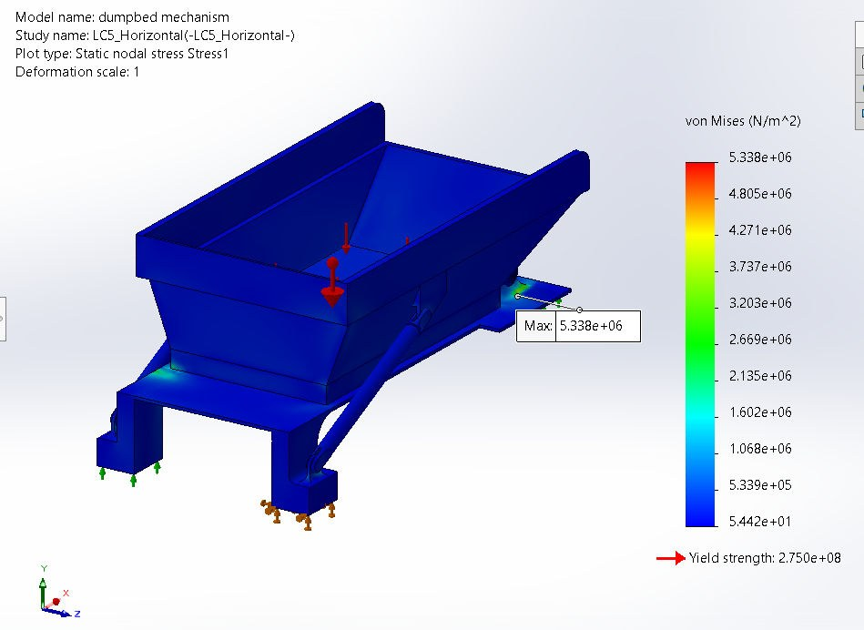

# Lunar Regolith Transport Rover for Habitat Shielding Support

**Conceptual lunar rover that hauls regolith to build radiation shielding for a lunar habitat.**
Independent aerospace design / research project, Summer 2026 — Rutgers University,
advised by Dr. Haym Benaroya. Second NJSGC award, Spring 2027, continues this project
(wiring setup, circuit diagram, and mechatronics).

## What it does

The rover carries externally excavated loose regolith from a prepared stockpile to a
habitat-side unloading zone, then dumps it — repeated trips, so the habitat crew can build
up radiation shielding. It transports and dumps; it does not excavate.

## What I did

- Full-assembly CAD in SolidWorks: six-wheel rocker-bogie mobility system, rear-hinged
  dual-actuator dump bed, fixed forward electronics deck
- Payload and sizing trade that set the 340 kg regolith payload and 0.315 m3 bed
- Mobility, wheel-torque, power, and motor analysis, plus a route and energy model
  (500 m one-way baseline, 180 trips, 196.2 km campaign)
- Hand structural calculations and preliminary FEA on 6061-T6 structural parts
- Electronics, communications, sensors, lighting, and harness integration

## Key results

| Metric | Final conceptual value |
| --- | --- |
| Payload | 340 kg regolith |
| Dry / loaded mass | ~650 kg / ~990 kg |
| Bed volume | 0.315 m3 |
| Suspension | Six-wheel rocker-bogie |
| Wheel diameter | 0.50 m |
| Route baseline | 500 m one-way |
| Required trips | 180 |
| Campaign distance | 196.2 km |
| Rover operating time | 611.1 h |
| Battery baseline | 48 V, 15 kWh |
| Trips per charge | 5.93 theoretical, plan 5 |
| Governing FEA case | LC5 asymmetric terrain support |
| Governing FEA result | 5.338 MPa, 0.1415 mm displacement, FOS 51.52 |

## Full report

[Lunar_Regolith_Transport_Rover_Final_Report_RUTGERS_ADVISOR_FINAL.pdf](Lunar_Regolith_Transport_Rover_Final_Report_RUTGERS_ADVISOR_FINAL.pdf)

## Status

Preliminary conceptual design and analysis — complete as an undergraduate design/research
project. Not flight-qualified hardware; it would need detailed structural, thermal,
electrical, RF, environmental, and test engineering before any build or flight use.

## Project Files

- [Final Conceptual Design Report](./Final_Conceptual_Design_Report.pdf)
- [One-Page Concept Summary](./One_Page_Concept_Summary.pdf)

## Weekly Deliverables

- [Week 1: Project Objective and Scope](./weekly-deliverables/Week01_Project_Objective.pdf)
- [Week 2: Regolith Transport and Payload Trade](./weekly-deliverables/Week02_Regolith_Transport_Trade.pdf)
- [Week 3: Mission Architecture and Preliminary Concepts](./weekly-deliverables/Week03_Mission_Architecture.pdf)
- [Week 4: Rover Sizing and CAD Block Model](./weekly-deliverables/Week04_Rover_Sizing_CAD.pdf)
- [Week 5: Mobility, Wheel Torque, Power, and Motor Selection](./weekly-deliverables/Week05_Mobility_Torque_Power.pdf)
- [Week 6: Rocker-Bogie Suspension CAD](./weekly-deliverables/Week06_Rocker_Bogie_CAD.pdf)
- [Week 7: Dump-Bed Floor Hand Calculations](./weekly-deliverables/Week07_Dump_Bed_Hand_Calcs.pdf)
- [Week 8: Rocker-Bogie Component FEA](./weekly-deliverables/Week08_Rocker_Bogie_FEA.pdf)
- [Week 9: Route Layout, Trip Time, and Construction Campaign Model](./weekly-deliverables/Week09_Route_Operations.pdf)
- [Week 10: Chassis, Electronics, and Dump-Bed Integration](./weekly-deliverables/Week10_Chassis_Dump_Bed_Integration.pdf)
- [Week 11: Integrated Dump-Bed/Chassis FEA](./weekly-deliverables/Week11_Integrated_FEA.pdf)
- [Week 12: Electronics, Communications, Sensors, Lighting, and Harness Integration](./weekly-deliverables/Week12_Electronics_Integration.pdf)

## Final Status

This project reached the preliminary conceptual design and analysis stage and is complete as an undergraduate aerospace engineering design/research project. It is not flight-qualified hardware and would require detailed structural, thermal, electrical, RF, environmental, and test engineering before any build or flight use.
